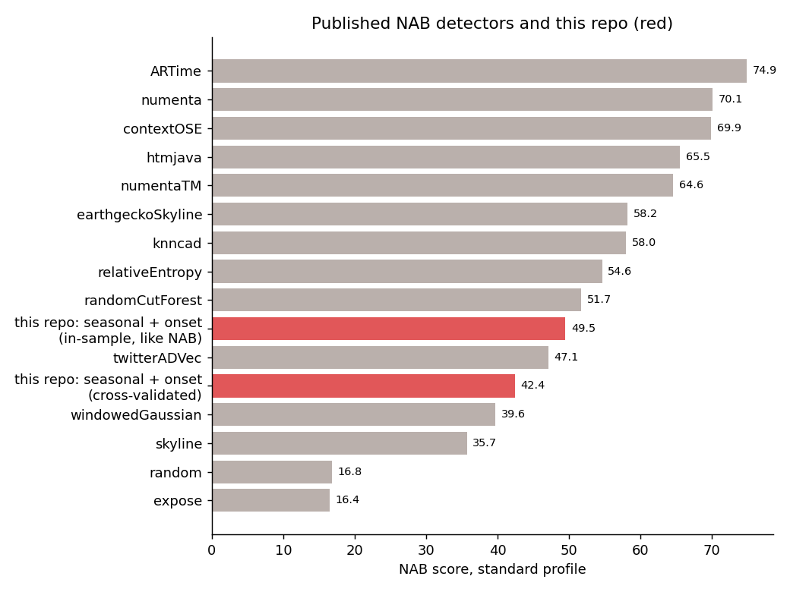
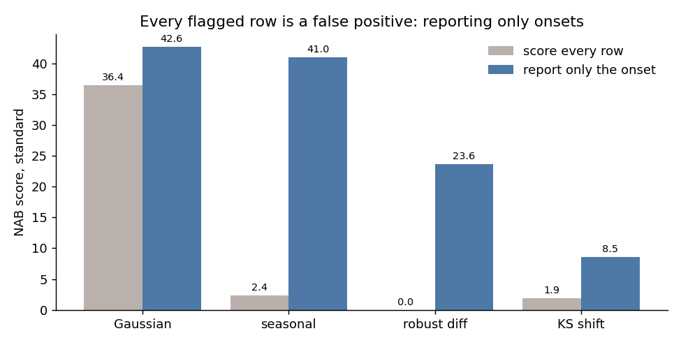
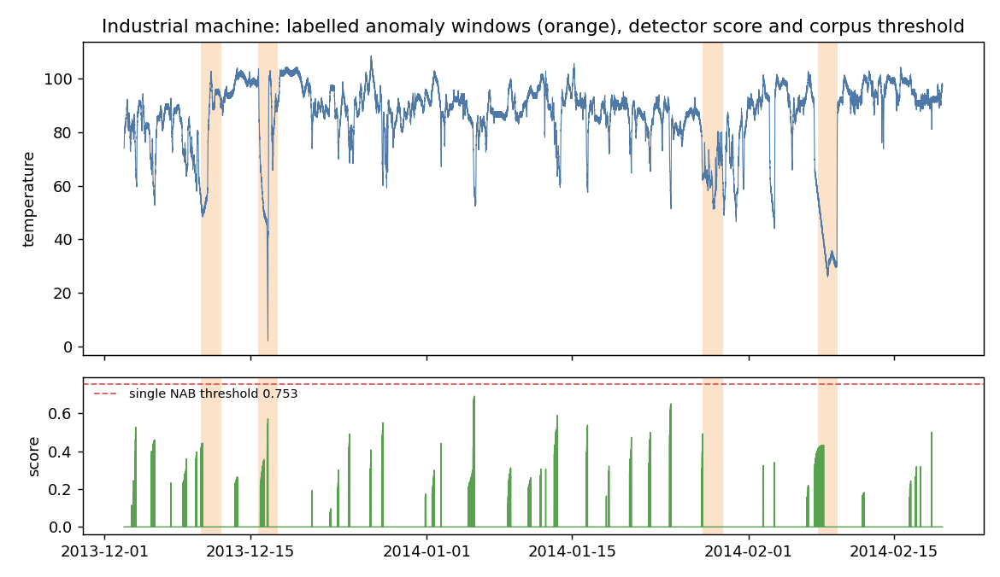

[English](README.md) | **Español**

# Detección de anomalías en streaming sobre el Numenta Anomaly Benchmark


El Numenta Anomaly Benchmark (NAB) son 58 series de tiempo reales y artificiales (CPU de servidores,
temperatura de máquinas, tráfico, clics en anuncios, volumen de tweets) con ventanas de anomalía
etiquetadas, y una regla de puntaje pensada para monitoreo: las detecciones tienen que ser en línea,
detectar temprano vale más y cada falsa alarma cuesta. Reimplementé el scorer, lo validé contra los
resultados publicados por NAB y construí detectores en línea simples para ver qué es lo que realmente
mueve el puntaje.

## Resultados

| | Puntaje NAB estándar |
|---|---|
| **Residuo estacional + reporte de inicio, con validación cruzada** | **42,4** |
| Mismo detector, con parámetros y umbral elegidos sobre todo el corpus (la convención de NAB) | 49,5 |
| Baseline publicado `windowedGaussian` | 39,6 |
| Numenta HTM publicado / mejor publicado (ARTime) | 70,1 / 74,9 |



### 1. Un scorer confiable antes que cualquier detector

El puntaje NAB es fácil de implementar mal en detalles finos (sigmoide escalada dentro de las
ventanas, período de prueba, un único umbral para todo el corpus, normalización contra un detector
nulo). Puntuando con esta implementación las salidas publicadas de los propios detectores de NAB se
reproduce `final_results.json` **exacto, 9 de 9** (windowedGaussian, numenta y random, tres perfiles
cada uno) en los umbrales guardados por NAB. Una búsqueda exhaustiva de umbral puede superar levemente
a esos umbrales guardados (+0,1 a +0,8 puntos), así que los números dentro de muestra de aquí son
comparables con los publicados con un margen de un punto.

### 2. Lo que más importa no es el detector sino lo que reporta



NAB cobra cada fila marcada fuera de una ventana como falso positivo. Un detector que queda alto
cincuenta filas después de un cambio de nivel paga cincuenta veces. Reportar un puntaje solo cuando
supera todos los puntajes de las k filas anteriores (el *inicio* de una excursión), sin mirar el
futuro, lo cambia todo: el detector estacional pasa de 2,4 a 41,0, el gaussiano de 36,4 a 42,6 y el
de diferencias robustas de 0 a 23,6.

### 3. Ajustar sobre el benchmark infla el puntaje

La ventana de inicio k importa: el detector estacional saca 20 con k = 25 y 49,5 con k = 400. Elegir
k sobre todo el corpus es ajustar sobre el conjunto de prueba, así que también puntúo dejando una
categoría fuera: k y el umbral se eligen con las demás categorías, y la que queda fuera se puntúa con
esos valores fijos.

| Detector | Mejor dentro de muestra | Validación cruzada | k elegido en cada partición |
|---|---|---|---|
| Gaussiano + inicio | 44,6 | 30,4 | 100 u 800, según la partición |
| **Estacional + inicio** | 49,5 | **42,4** | 400 en todas |
| Gaussiano o estacional + inicio | 49,0 | 41,6 | 400 en todas menos una |

El detector estacional conserva casi todo su puntaje y elige siempre el mismo parámetro; el gaussiano
pierde 14 puntos y su mejor parámetro depende de qué datos ve. La mayoría de los números publicados de
NAB son dentro de muestra en este sentido.

### 4. Dónde falla: un solo umbral para todo

Puntajes por categoría (dentro de muestra, perfil estándar): artificiales 91,1, tweets 68,5, tráfico
58,9, AWS 55,8, anuncios 46,7, **causa conocida 27,1**.



En la serie de temperatura de una máquina industrial el detector reacciona dentro de tres de las
cuatro ventanas etiquetadas (puntajes máximos 0,43-0,57), pero en períodos normales aparecen puntajes
parecidos, y el umbral único de NAB, 0,753, queda sobre todos ellos, así que no se marca nada. Para
monitorear un equipo concreto, un umbral por equipo o una línea base aprendida sobre esa máquina
importaría más que un detector mejor.

Se probó un post-proceso de "verosimilitud" (medir qué tan inusual es un puntaje bruto frente a su
propia historia, en la línea del anomaly likelihood de Numenta) y empeoró todos los detectores aquí;
queda en el código por completitud.

## Método

```
58 series de NAB (copia en Kaggle) + ventanas, perfiles y resultados publicados (NAB en GitHub)
   │
   ├── scoring.py    puntaje NAB: ventanas, sigmoide escalada, período de prueba, búsqueda de umbral
   │                 en todo el corpus, normalización nulo/perfecto; validado 9/9 contra lo publicado
   ├── detectors.py  solo en línea: z gaussiano móvil, tamaño de salto robusto (mediana/MAD),
   │                 residuo estacional contra la misma fase de días/semanas anteriores, cambio de
   │                 distribución KS, post-proceso de verosimilitud, reporte de inicio
   ├── run.py        cada detector x post-proceso sobre el corpus
   └── crossval.py   elección de k y umbral dejando una categoría fuera
```

## Datos

Numenta Anomaly Benchmark (Lavin y Ahmad, 2015; Ahmad et al., 2017). Series de la copia en Kaggle
[boltzmannbrain/nab](https://www.kaggle.com/datasets/boltzmannbrain/nab); ventanas etiquetadas,
perfiles de puntaje y resultados publicados de [numenta/NAB](https://github.com/numenta/NAB) (MIT).
Descargados en octubre de 2026; no se redistribuyen aquí.

## Reproducir

```powershell
python -m venv venv
.\venv\Scripts\python.exe -m pip install -r requirements.txt
$env:PYTHONPATH = "src"
kaggle datasets download -d boltzmannbrain/nab -p data/raw --unzip
python -m nabscore.labels       # ventanas, perfiles y resultados publicados desde GitHub
python -m nabscore.validate     # scorer contra los resultados publicados
python -m nabscore.run          # ~4 min la primera vez (los puntajes brutos quedan en caché)
python -m nabscore.crossval
python -m nabscore.figures
pytest -q tests
```

## Limitaciones

- Los detectores son deliberadamente simples y univariados; el objetivo es ver qué mueve el puntaje,
  no un nuevo estado del arte.
- La validación cruzada sobre siete categorías es gruesa: las categorías difieren mucho, y una no
  tiene anomalías.
- Las ventanas de NAB son de ancho fijo y en parte etiquetadas a mano; algunas etiquetas se discuten
  en la literatura.

## Licencia

Código: MIT. Datos: NAB (Numenta), vía Kaggle y GitHub, no se redistribuyen.
